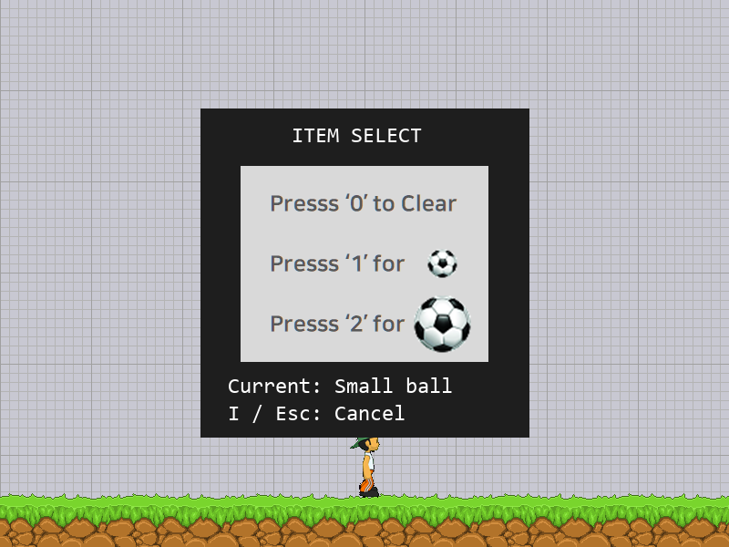

# Drill 13 — 아이템 모드 구현

2D 게임 프로그래밍 수업의 LEC15 게임 프레임워크를 바탕으로 만든 독립 프로젝트입니다.

## 실행

Python 3.11 이상에서 가상환경을 만들고 필요한 패키지를 설치합니다.

```powershell
python -m venv .venv
.\.venv\Scripts\python.exe -m pip install -r requirements.txt
.\.venv\Scripts\python.exe main.py
```

VS Code에서는 이 폴더를 열고 `.venv` 인터프리터를 선택한 뒤 `Drill 13: main.py`로 실행합니다.
이미지 경로는 각 코드 파일의 위치를 기준으로 처리하므로 상위 폴더에서도 실행할 수 있습니다.

## 기본 조작

| 화면 | 키 | 동작 |
| --- | --- | --- |
| 로고 | 2초 대기 | 타이틀로 이동 |
| 타이틀 | Space | 플레이 시작 |
| 타이틀 | Esc | 프로그램 종료 |
| 플레이 | ← / → | 이동 |
| 플레이 | Space | 공 발사, 자는 중에는 깨우기 |
| 플레이 | P | 일시정지 |
| 플레이 | I | 아이템 선택 화면 열기 |
| 플레이 | Esc | 타이틀로 돌아가기 |
| 일시정지 | P | 이어서 플레이 |
| 일시정지 | Esc | 타이틀로 돌아가기 |
| 아이템 선택 | 0 | 공 없음 선택 후 플레이로 복귀 |
| 아이템 선택 | 1 | 작은 공 선택 후 플레이로 복귀 |
| 아이템 선택 | 2 | 큰 공 선택 후 플레이로 복귀 |
| 아이템 선택 | I / Esc | 선택 변경 없이 플레이로 복귀 |
| 아이템 선택 | ← / → / Space | 이동 및 공 발사 계속 |
| 아이템 선택 | P | 일시정지, 다시 P를 누르면 아이템 화면으로 복귀 |
| 모든 화면 | 창의 X | 프로그램 종료 |

기본 아이템은 작은 공입니다. 공 없음을 선택하면 Space를 눌러도 새 공을 발사하지 않습니다.
선택은 앞으로 발사할 공에 적용되며 이미 발사한 공은 바뀌지 않습니다.
타이틀로 돌아갔다가 새 게임을 시작하면 기본 아이템으로 초기화됩니다.

플레이 중 5초 동안 가만히 있으면 캐릭터가 잠듭니다. I로 아이템 화면을 열어도 이동·발사와
공·애니메이션·수면 타이머는 계속 진행됩니다. 숫자를 고르거나 창을 닫아도 시간은 보정하지 않습니다.
P로 일시정지했을 때만 캐릭터와 공, 수면 타이머를 멈추고, 정지 중 놓은 방향키를 재개할 때 반영합니다.

## 아이템 화면



## 검증

```powershell
.\.venv\Scripts\python.exe -m unittest discover -s tests -v
```

실제 SDL 이벤트와 이미지 렌더링을 사용하는 테스트 13개가 통과했습니다.
0·1·2 선택과 공 발사, 선택 취소, 아이템 화면에서 계속되는 플레이, P 정지와 시간 보정,
방향키 해제, 아이템 화면에서 P 정지·재개 및 Esc 복귀, 반복 진입 시 중복 방지,
P 길게 누르기, 수면 상태, 새 게임 초기화 및 창 닫기를 검사합니다.
실행 가능한 SDL 그래픽 환경이 필요합니다.

`main.py`를 상위 폴더에서 실행해 로고 2초 → 타이틀 → 플레이 → 아이템 세 종류 선택 →
P 정지·재개 → 타이틀 → 종료까지 실제 게임 루프로도 확인했습니다.

## 이전 작업 이력

오늘 작성한 타이틀·플레이·정지 모드 커밋을 포함해, 게임 폴더의 변경 이력을 가져왔습니다.
원본과 새 커밋의 대응은 [docs/HISTORY.md](docs/HISTORY.md)에 기록했습니다.
AI와 함께 진행한 요구사항과 검증 기록은 [docs/AI_USAGE.md](docs/AI_USAGE.md)에 정리했습니다.
